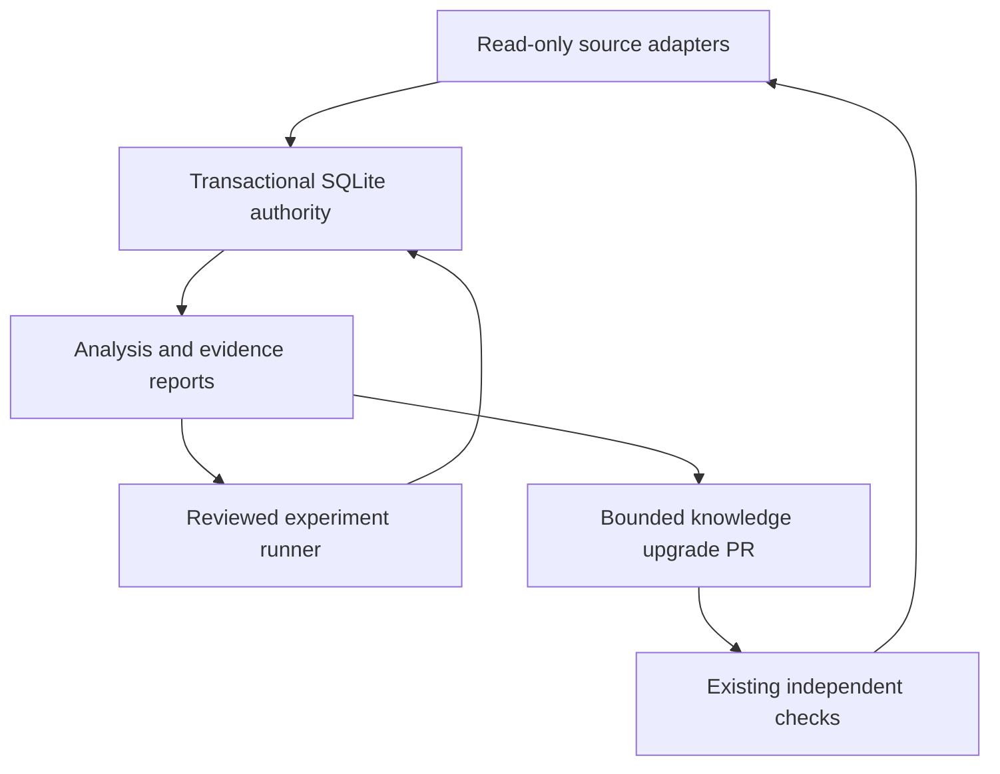

# Portfolio Brain replacement

The mission is autonomous research, maintenance, repairs and useful upgrades across
all registered projects. Prioritize reliability, correctness, usability and reduced
manual work. Revenue and financial holdings are optional project-specific inputs.

Three runtime responsibilities: source acquisition, state authority, and intelligence.
Reporting and the reviewed experiment are ordinary library code, not services. The existing
scheduled core owns execution; v8 adds no second scheduler. No legacy package, artifact namespace, reducer,
writer lock, agent heartbeat, cost governor, or orphaned-run cleanup is imported by
`brain/`. The existing protected merge verifier is preserved byte-identically.

## State guarantees

- SQLite `BEGIN IMMEDIATE`, full durability, bounded busy timeout, one visibility policy.
- Whole input batches validate before a committed acknowledgement. Identical event IDs
  are no-ops; reused IDs with different content reject the entire batch.
- Pending input is durable. Reduction commits ledger entries and applied dispositions
  together. An interruption rolls the entire drain back; restart reapplies exactly once.
- Every event has a contiguous sequence, source revision, semantic timestamp, data label,
  payload digest, previous digest, and chain digest. Missing/corrupt/ambiguous evidence fails closed.
- A canonical event ID is bound to the exact complete event content using the
  existing producer contract: `<kind>:SHA256(canonical(event with id=""))`.
  Intake and every verified historical ledger replay rederive this identity;
  invented IDs or copied IDs from a different event fail even if SQLite row
  identities, body hashes and chain hashes were all recomputed consistently.
  Events legitimately repeated by a new producer revision or using an
  equivalent UTC-text precision are still independently identified and allowed
  when the semantic observation matches.
- Event keys for repository, candidate implementation, and reviewed experiment records
  must match their validated payload identities exactly; repository source URLs
  must name the actual recorded commit, not merely share the repository URL prefix.
  These checks apply during intake and full ledger replay, without modifying old
  records. Operator feedback and named holdings retain their existing key flexibility.
- Repeated kind/key/semantic-time observations (including different UTC timestamp
  text precision for the same instant) must match on payload, ACTUAL/SIMULATED/
  ESTIMATED classification, and PUBLIC/PRIVATE visibility. Replays from a different code
  revision are allowed only for those identical observed facts. A conflicting label is
  rejected atomically at ingestion and during whole-history ledger replay even when
  a later observation superseded it; no change of event ID can upgrade simulated
  observations into actual evidence. No canonical state history is rewritten.
- Reports replay deterministically from verified events. A self-consistently rehashed
  fabricated report still fails the ledger comparison. Pending input blocks reads.
- Delayed observations remain history and cannot replace newer semantic source facts.
- Report generation time never makes old source data current. Code revision, projection
  sequence, semantic age, current complete workload coverage, and doctor freshness are separate checks.
- Backup creates an exclusive 0600 staging file in an owner-controlled,
  non-group/world-writable destination directory, then uses the SQLite
  backup API. It verifies integrity, foreign keys, and canonical event/ledger
  identity on the snapshot before atomic replacement, refusing symlinked or
  hard-linked targets and preserving existing backups when validation fails.
  The backup command neither drains pending state nor writes a secondary
  failure report to a caller-supplied backup filename. Git publication uses
  one new commit from a captured state parent, rejects main/parent drift,
  and never force-pushes.
- Public state rejects private input atomically. Private local state has no automatic publication path.
- Local JSON/Markdown/HTML report publication uses private 0600 staging files,
  secure 0700 output directories and per-file atomic replacement; it refuses
  symlink/hardlink output targets, pre-existing shared destination directories,
  and symlink ancestors instead of chmod'ing unrelated files. JSON is published
  last as the canonical machine-readable receipt; a three-file bundle is not
  a single atomic filesystem transaction. Render-path failures cannot create
  a second failure artifact inside the rejected directory.

## Intelligence contracts

The report's `repository_changes` projection compares the two latest distinct
semantic observation times per repository using the verified immutable ledger,
not arrival order or external polling. It reports revision movement and the net
GitHub `open_issues_count` tally (which includes pull requests), and records
check deterioration/recovery only for uniquely named, completed checks observed
on the **same exact revision**. Missing checks, duplicates, pending checks, and
changed revisions never imply recovery or passing coverage. Each comparison
retains its two source references, timestamps and ACTUAL_FRESH/NON_ACTUAL/
HISTORICAL/ACTUAL_STALE_BASELINE evidence quality. ACTUAL_STALE_BASELINE
means the latest actual snapshot is within the configured freshness window but
the earlier actual snapshot is outside it: measured differences are preserved,
while no current-period change timing or recent recovery is inferred. At the
freshness boundary, an age exactly equal to max_age remains eligible; one
second beyond is stale. An old baseline must not make the entire report stale
when the latest independently observed source is fresh. A conflicting
historical same-time observation blocks the projection even when the newest
observation is unambiguous.

### V5-to-V6 stored-report replay after a long observation gap

The original V5 source `3fb0bb0dcc28f961033d782260c31f36ed78eb71`
classified a fresh latest ACTUAL sample against an expired ACTUAL baseline
as `ACTUAL_FRESH`. V6 deliberately changes that **derived** comparison
label to `ACTUAL_STALE_BASELINE`. If a persisted V5 report happens to
contain such a comparison, V6's strict `Store.read_report` recomputes
the new projection and **rejects** the older report, even when that older
report's stored hash is internally valid. This is fail-closed **projection
version drift**, not evidence that the immutable SQLite event ledger is corrupt.
Never bypass the deterministic report comparison or rewrite old reports.

To prepare a new source safely, independently verify the original SQLite
snapshot, ledger chain, and source, then **on a disposable copy** use V6
`Store.report(new_source_sha)` to append a fresh report derived from those
unchanged events. Re-read with `Store.read_report(new_source_sha)`, verify
the original event IDs and chain hashes are unchanged and that the V5 report
row was preserved, and only then consider a governed source transition.
The scheduled V6 sequence also calls `monitor` (which regenerates its
report) before `research` and `doctor`, but a passing synthetic copy is
not a completed live acceptance period. Previous reports remain historical;
they do not automatically inherit V6 evidence labels. Tests include
a synthesized, faithfully V5-labeled stale-baseline report, its strict
rejection under V6, safe candidate regeneration, and rejection of a
self-consistently rehashed fabricated tally. The audited actual October 12
V5 snapshot had **zero** expired baselines and independently replayed
successfully; do not describe this potential gap as an observed outage.

These are state differences, not verified technical improvement, commercial
value, root-cause attribution, or authorization to take action. The new
projection needs no new workflow, provider query, database, or service.

Repository checks are observed diagnostics, not proof of useful work. The
GET-only monitor rejects truncated/changed pagination, repeated/invalid
provider check-run IDs even for <=100 checks, and checks tied to a different
SHA. It reads the exact default-branch revision before and after the check
collection and refuses a moved branch instead of describing stale checks
as the latest state. This bounded second read does not freeze GitHub's
branch after the observation or prove CI/check behavior was useful.
Discovery inspects actual exact-revision source bytes, verifies Git blob hashes, and records
SHA-256 plus structural test paths. Search-index results can disappear before inspection:
only an optional public search hit's missing default branch with exact integer
`size=0` is quarantined at the branch stage. Nonempty, absent/bool/noninteger
sizes and private-mode branch 404s fail closed. Separately, a vanished
search-derived public tree/blob GET 404 can be quarantined with repository
and stage evidence, but hash/identity failures are never waived. A research
PASS with any skipped source requires another actually hash-verified source;
otherwise it fails with `DISCOVERY_ALL_SEARCH_RESULTS_UNAVAILABLE`.
Search endpoint failure, non-404 transport failure, private/malformed
metadata, truncated trees and explicitly requested repository 404 remain
hard failures. Gaps are not presented as verified or complete research. No new
provider, extra pagination or retry budget is introduced.
Licenses are metadata without a discovery filter.
No instruction in a README, comment, repository name, or fetched source can grant
mutation authority. Fetched code is never executed.

Reuse ranking explains its integer features: observed tests, matched capability
terms, and bounded implementation size. It is not a probability of usefulness.
Feedback remains explicitly operator-reported unless independently verified by a
future approved adapter. Memory stores observations, outcomes, and experiment history;
there is no claim of model-weight training or general intelligence improvement.

Experiments execute only shipped, reviewed, bounded implementations against explicitly
simulated positive/negative inputs. Duplicate-invoice tuple indexing proves the defined
correctness/operation-count claim only; freight recovery validity, commercial demand,
engineering time savings, and revenue remain unverified. New candidates produce
project-specific evaluation plans, not automatic downstream integrations.

Self-upgrades are limited to a fixed public reuse-knowledge file, with three fresh
actual implementation-and-test sources, no private content, one proposal per week,
and the unchanged Foundation/App gate. Arbitrary generated code repair, automatic
third-party integration, paid reasoning, and customer-facing business operations
are not implemented. Source/API failure recovery and inbox replay are automatic.

Holdings calculations require complete prices, finite nonnegative values, explicit
source permission attestation, UTC semantic times, and aligned historical data.
A newly submitted holdings event cannot claim more reliable evidence than any
underlying current quote **or historical price observation**: SIMULATED dominates
ESTIMATED, which dominates ACTUAL. Conservative over-labeling is permitted.
All mixed-source holdings views separately expose valuation and historical
kinds, quote/history source references and an explicit statement that source
claims have **not** been independently verified. ACTUAL means operator/source
reported rather than exchange-authenticated. Archived V4 facts are not rewritten:
any older understated label is preserved in `declared_data_kind`, while the
derived `data_kind` is conservatively downgraded and the discrepancy flagged.
Missing cost basis means P/L unavailable. Historical results use current quantities
and are labelled fixed-holdings scenarios; no realized performance, annualization
assumption, future estimate, order instruction or position recommendation is invented.

## Acceptance sequence

PREPARE → EXACT-SHA PREFLIGHT → PRE-ARM → SOAK → POST-SOAK VALIDATION.

Preflight covers state integrity/replay, retrieval validation, experiments, reporting,
privacy, concurrency, interruption, and known stale-state regressions locally. Main
must remain unchanged throughout hosted execution. Live pre-arm additionally requires
all four configured source observations, research, experiment, current doctor PASS,
zero pending events, verified restored/published state and actual run/artifact identities.
The six coverage classes replace the old eight asynchronous workflow dependencies.

An authorized soak must capture its start commit, state parent, every complete cycle
receipt, continuity gaps/failures and source freshness, then run the doctor/replay and
verify final delivery. Elapsed time alone cannot pass it. No soak authorization or
completed soak is implied by an hourly scheduled cycle.

## Requirement classification before integration

| Major requirement | Status | Evidence or limit |
|---|---|---|
| Canonical scope and preservation | PASS | Exact source commits and verified recovery refs; workflow hashes |
| Smaller active architecture | PASS | Three responsibilities; one recurring owner;40 inert workflow archives |
| State integrity, concurrency, restart | PASS | Deterministic and independently written adversarial tests |
| Useful source/knowledge/experiment/report pipeline | PASS locally | Unit/integration tests; live demonstration evidence recorded separately |
| Read-only financial-input analysis | PASS locally | Explicit input calculations; no licensed feed connected |
| Public/private code discovery | PASS implementation | Public live evidence separately; private live access NOT TESTED |
| Commercial value and revenue improvement | NOT TESTED | Hypotheses do not establish demand, revenue, or engineering savings |
| General autonomous code repair/upgrades | BLOCKED | Only bounded knowledge PR upgrades implemented; arbitrary self-repair absent |
| Continuous never-interrupted autonomy | BLOCKED | Hourly GitHub runtime; external continuous host not provisioned |
| Protected GitHub integration | NOT TESTED here | Exact PR/head checks required; see delivery record |
| Exact-main hosted pre-arm | NOT TESTED here | Main-only live cycle must publish and verify doctor/delivery |
| Lengthy soak and post-soak | NOT TESTED | Explicit authorization required; no soak launched |
| Legacy orphan repair | BLOCKED | GitHub run37655516971 remains queued; issue640 stays open |

## V8 engineering integration

The supported owner interface is `python -m brain.v8 cycle`. It consumes the
already-collected, source-bound project report and uses the v8 kernel to issue
at most five fair, incident-first owner handoffs. The optional existing-core
step emits a separate diagnostic artifact; it does not write the canonical DB,
grant permissions, execute fetched code or certify release. An optional-step
failure is not a successful v8 handoff and must remain visible in original logs.

Project contracts, recipe tests, deployed asset observations, private task
reconciliation, recovery supervision and outcome memory have separate modules
under `brain/v8`. Their supported capabilities and remaining production gates
are in [V8_ENGINEERING_LOOP.md](V8_ENGINEERING_LOOP.md). The current kernel refuses
release-state advancement without an independent adapter.

The legacy packages remain CI dependencies: Foundation explicitly compiles and
executes their validation CLIs and regressions. The established core, clock,
state schema and signed provenance path remain active. No package can be removed
based solely on version age or absence from static `brain` imports. Preserve
source/state history, existing watchdog recovery and protected verification.
